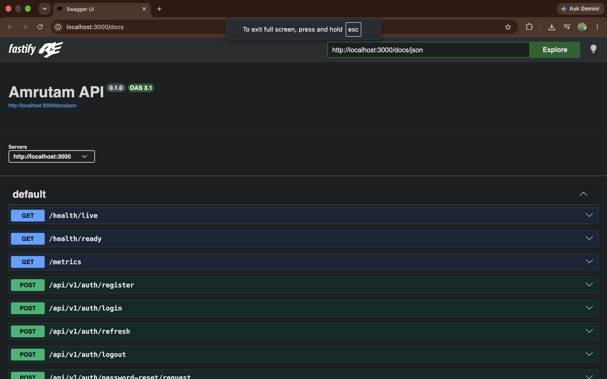
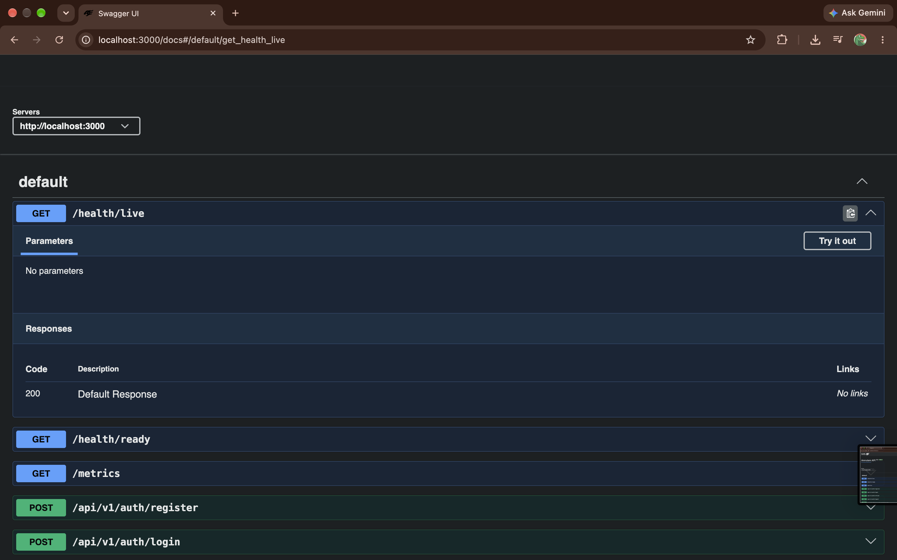
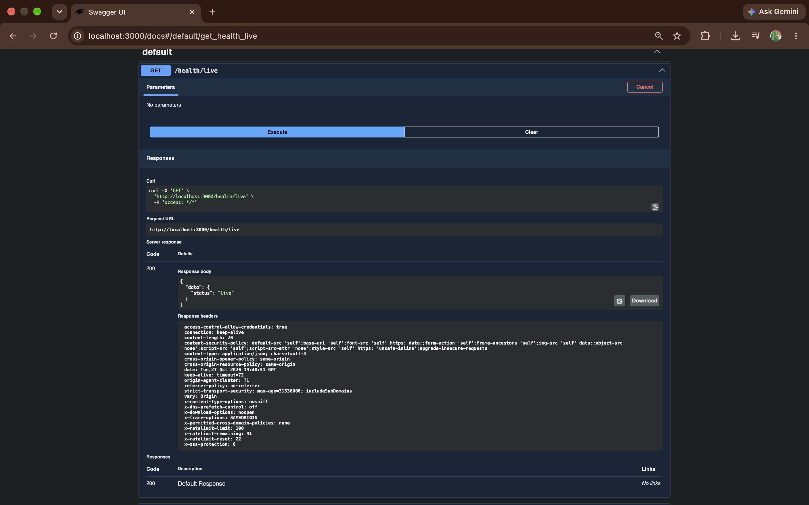

# Amrutam API (MVP)

A TypeScript/Fastify modular monolith starter for a telemedicine booking service. PostgreSQL is the source of truth for bookings; Redis is provisioned for later bounded background work and must not be required for booking correctness. This is an engineering MVP, not a claim of production readiness, healthcare compliance, or achieved capacity/availability targets.

## Local setup

Prerequisites: Node.js 22, npm, Docker Compose (or a local PostgreSQL server). Copy `.env.example` to `.env`, set random values for `JWT_SECRET` and `POSTGRES_PASSWORD`, keep the database URL password in sync, and start dependencies:

```sh
cp .env.example .env
docker compose up -d postgres redis
npm ci
npx prisma generate
npm run db:deploy
npm run dev
```

API: `http://localhost:3000`; OpenAPI UI: `http://localhost:3000/docs`; liveness/readiness: `/health/live` and `/health/ready`; metrics: `/metrics`. For a fully containerized run, use `docker compose up --build` (local-only default database password must be changed before exposure).

## API screenshots

The screenshots below show the local Swagger UI and a successful liveness check:

### Swagger API overview

The overview shows the generated OpenAPI 3.1 documentation and the route groups available in Swagger UI.



### Liveness endpoint before execution

The health route has no request parameters. Use **Try it out** and **Execute** to call `GET /health/live` from Swagger UI.



### Successful liveness response

The executed request returns HTTP 200 with `{"data":{"status":"live"}}`, along with response headers. This indicates that the API process is serving requests; use `/health/ready` to check the database dependency.



Implemented route groups include `/api/v1/auth/*`, `/api/v1/users/me`, `/api/v1/doctors`, `/api/v1/availability`, `/api/v1/consultations`, and `/api/v1/admin/analytics/consultations`. Password reset endpoints are placeholders; `/api/v1/prescriptions/*` and `/api/v1/payments/*` are not implemented. See [API examples](docs/API_EXAMPLES.md).

## Commands

```sh
npm run typecheck
npm test
npm run build
npm run audit
npm run db:seed       # creates explicitly local demo identities
```

No seeded demo credentials are included until the seed script runs. Never use its credentials in a shared environment. `POST /api/v1/auth/register` creates a patient. `POST /api/v1/auth/login` returns short-lived bearer access and opaque refresh tokens. Use `Authorization: Bearer <accessToken>` and an `Idempotency-Key` for `POST /api/v1/consultations`.

## Architecture and security

See [Architecture](docs/ARCHITECTURE.md), [Security](docs/SECURITY.md), [Operations](docs/OPERATIONS.md), and [Assumptions](docs/ASSUMPTIONS.md). Implemented controls include Argon2id, JWT issuer/audience validation, refresh token rotation with family revocation on reuse, role checks, patient/doctor scoping, request validation and limits, CORS allowlist, security headers, structured logs with basic credential redaction, PostgreSQL uniqueness for slot reservation, and transactional audit/outbox writes.

See [delivery progress](docs/PROGRESS.md) for the verified phase checklist and remaining work.

Privileged doctors and administrators must enroll with TOTP and verify MFA at login; MFA secrets are AES-GCM encrypted at rest. Password reset tokens are hashed, expire after 30 minutes, are single-use, and revoke refresh sessions. The local/test API returns the reset token for development because no email provider is configured; production delivery is still required. Remaining gaps: prescription and payment workflows, webhook signature handling, Redis/BullMQ workers, OpenTelemetry tracing, and broader lifecycle/authorization tests. Patient cancellation is limited to 24 hours before the slot, while doctor cancellations are allowed. No mock payment provider is wired yet. Do not use this MVP for real patient data or payments.

## CI and observability

GitHub Actions runs Prisma generation/migration, type checking, lint, Vitest, npm audit and a container build. Container vulnerability scanning and SBOM publication still need to be added. Prometheus scrape and Grafana dashboard provisioning files are under `monitoring/`; add a Prometheus and Grafana service to a controlled observability environment and restrict the metrics endpoint at the network layer. Current metrics cover process defaults and HTTP request count/duration.

## Deployment

Vercel deployment configuration is included. Vercel detects `src/server.ts` as the Fastify entrypoint; the function is pinned to Mumbai (`bom1`) and uses a small PostgreSQL pool. See the [Vercel deployment guide](docs/VERCEL_DEPLOYMENT.md) for managed database, secrets, migration, preview, and deployment steps. No Vercel project is linked and no deployment has been created. This is deployable infrastructure for the current API MVP, not a production-ready telemedicine service: rate limiting is process-local and prescriptions, payment integrations, workers, email delivery, and compliance validation remain incomplete.

Terraform baseline is under `infra/terraform`; it describes an illustrative AWS network, encrypted RDS database and managed database-secret foundation. It does not deploy the application or Redis and deliberately creates no resources unless explicitly applied. Review IAM, subnet policy, backups, alerting, and threat model before use. See [Deployment and recovery](docs/OPERATIONS.md).

## Proposed commit plan

1. `feat: add Fastify foundation and Prisma data model`
2. `feat: implement auth and transactional appointment booking`
3. `test: cover API safety and concurrent booking`
4. `docs: add security, operations, and deployment baseline`

## Submission status

The included implementation is deliberately a runnable MVP slice rather than a representation that every assignment workflow is complete. See [Test plan](docs/TEST_PLAN.md) and [Demo script](docs/DEMO_SCRIPT.md) for verified scope and known limits.

